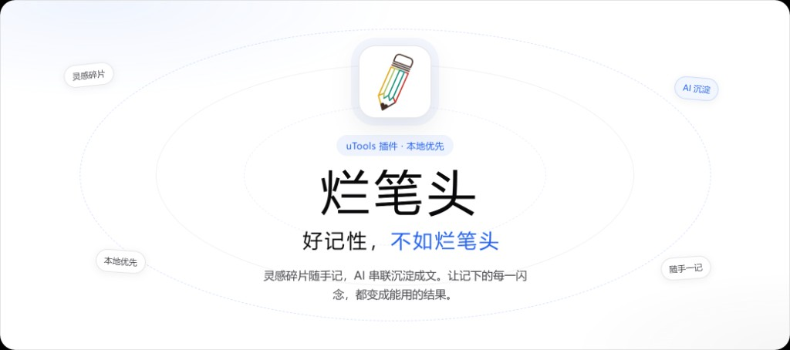

<p align="center">
  
</p>

# 烂笔头 · AI 笔记与助理

<p align="center">
  
</p>

面向 [uTools](https://www.u.tools/) 的本地 AI 笔记插件：随手记碎片、全局搜索、问 AI、沉淀成长文，数据落在本机，无需自建后端。

## 插件特点

- **碎片随手记** — 底部输入栏快速记下文字 / 图片；也可在任意场景选中文字、图片，用「记录到烂笔头」直接入库
- **问 AI** — 基于你的笔记上下文对话：检索、归纳、追问；支持 uTools AI、智谱、DeepSeek、通义、Kimi、OpenAI、Claude，以及自定义 OpenAI 兼容接口
- **沉淀成文** — 把碎片组装成结构化长文，Markdown 编辑 + AI 辅助起草
- **全局搜索** — 跨碎片与沉淀全文检索，支持标签、日期筛选
- **待办与项目** — 本地待办、项目整理，可配合 AI 生成文案
- **批量智能** — 多选碎片批量打标签、AI 自动归类
- **本地存储** — 数据保存在 uTools 本地数据库；支持导出 / 导入备份包，以及导入 Markdown
- **Agent 工具** — 向 uTools Agent 暴露搜索碎片、读取笔记、列出标签等能力

## 环境要求

- [uTools](https://www.u.tools/) 客户端
- Node.js `^20.19` 或 `>=22.12`（仅开发 / 打包需要）

## 使用方式

### 方式一：开发调试（推荐贡献者）

```sh
git clone https://github.com/Hxd123459/lanbitou-uTools.git
cd lanbitou-uTools
npm install
npm run dev
```

1. 打开 uTools → **插件应用** → **开发者工具** → **创建项目**
2. 选择本仓库的 `public/plugin.json`（开发模式下指向 `http://localhost:5173`）
3. 保存后，在 uTools 输入 `烂笔头` / `笔记` / `lanbitou` 唤起插件

选中文字或图片后，可用「记录到烂笔头」「记录图片到烂笔头」；输入内容也可用「搜索笔记」做主推搜索。

### 方式二：打包后安装

```sh
npm install
npm run build:utools
```

构建产物在 `dist/`。在 uTools 开发者工具中把插件目录指向 `dist`（或使用其中的 `plugin.json`）即可本地安装体验。

> 正式发布到 uTools 应用市场时，请以市场审核要求为准提交 `dist` 产物。

### 首次使用建议

1. 打开插件 → **设置** → **AI 设置**，选择服务商并填写 API Key（选「uTools AI」则走平台额度，无需 Key）
2. 用底部输入栏记几条碎片，或从系统选中文字 / 图片一键入库
3. 需要时打开 **问 AI**、**全局搜索**，或把相关碎片 **沉淀** 成长文
4. 重要数据请在设置里定期 **导出全部数据** 做备份

## 常用脚本

| 命令 | 说明 |
|------|------|
| `npm run dev` | 本地开发（Vite，端口 5173） |
| `npm run build:utools` | 打包为 uTools 可加载的 `dist` |
| `npm test` | 运行单元测试 |

## 技术栈

Vue 3 · Vite · Pinia · TipTap · uTools DB（本地）

## 说明

本仓库为 **uTools 插件版**，数据与 AI 均在本地 / 用户自备密钥下运行，不依赖单独的后台服务。Web 自托管版不在本仓库范围内。

## License

尚未指定开源协议。使用或二次分发前请与作者确认。
